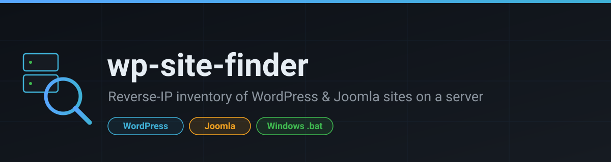
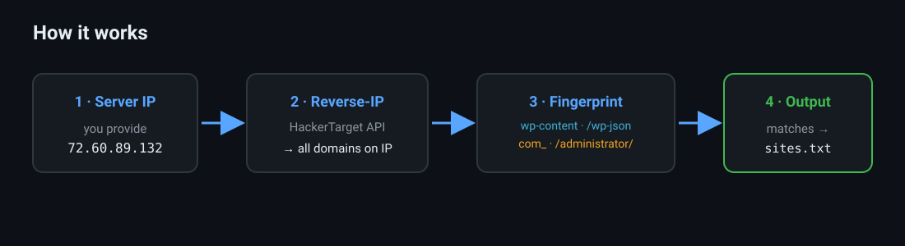
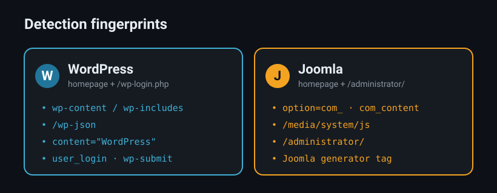
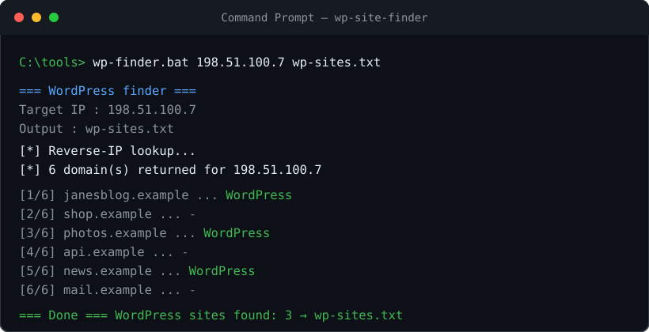

<p align="center">
  
</p>

<p align="center">
  
  
  
  
</p>

# wp-site-finder

Windows command-line tooling to **inventory the WordPress and Joomla sites
hosted on a server IP**. Give it an IP, it returns the domains on that IP and
flags which ones run WordPress or Joomla, writing the results to a text file.

> **Scope / intended use.** These are inventory and reconnaissance tools for
> infrastructure **you own or are explicitly authorized to assess** (your own
> servers, a client engagement with permission, an in-scope bug-bounty target).
> They detect *which CMS a site runs* — nothing more. Don't use them to build
> target lists of third-party sites you have no permission to touch.

---

## How it works

<p align="center"></p>

1. **Reverse-IP lookup** — the [HackerTarget](https://hackertarget.com/) API
   returns every domain pointing at the IP.
2. **Fingerprint** — each domain's homepage (and CMS login path) is fetched and
   scanned for WordPress / Joomla markers.
3. **Output** — matches are written, one per line, to a `.txt` file.

<p align="center"></p>

---

## Scripts

| Script | Detects | Output |
|--------|---------|--------|
| `wp-finder.bat` | WordPress | `[output.txt]` arg, default `wordpress-sites.txt` |
| `joomla-finder.bat` | Joomla | `[output.txt]` arg, default `joomla-sites.txt` |
| `cms-finder.bat` | **both** in one pass | `wpresult.txt` + `joomlaresult.txt` |

```bat
wp-finder.bat     198.51.100.7 wp-sites.txt
joomla-finder.bat 198.51.100.7 joomla-sites.txt
cms-finder.bat    198.51.100.7
```

`cms-finder.bat` scans once and writes each CMS to its own file —
WordPress domains to `wpresult.txt`, Joomla domains to `joomlaresult.txt`,
one domain per line.

<p align="center"></p>

**Requirements:** `curl` (built into Windows 10 1803+ / Windows 11).

**Limits:** the free HackerTarget reverse-IP API is rate-limited (~50 lookups/day
per source IP) and its index is partial — strongest on large shared-hosting IPs.
An IP with nothing indexed returns `No DNS A records found`, which the scripts
report and exit on cleanly.

---

## Dork lists

`wp-dorks.txt` and `joomla-dorks.txt` hold **fingerprinting** Google dorks —
queries that identify *that a site runs* WordPress / Joomla. Paste one line into
a search engine; combine with `site:` to scope to a domain or TLD. They are not
for automated scraping (Google will CAPTCHA scripted queries) — use a SERP API
(Google Custom Search JSON API, SerpApi) if you need it programmatic.

---

## License

MIT — see `LICENSE`. Use responsibly and only where you are authorized.
